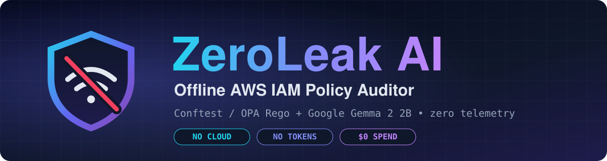

<div align="center">


<br><br>

# 🛡️ ZeroLeak AI

### Offline AWS IAM Policy Auditor
**A deterministic rule gate (OPA / Conftest Rego) plus a local open-weight model (Google Gemma 2 2B)**

[](LICENSE)
[](https://ai.google.dev/gemma)
[](https://www.conftest.dev/)
[](docs/ARCHITECTURE_PLAN.md)
[](docker-compose.yml)

[](https://python.org/)
[](https://ollama.com/)
[](https://streamlit.io/)
[](https://terraform.io/)
[](https://aws.amazon.com/iam/)
[](https://dev.to/challenges/hacktoberfest-week2-2026-10-12)

<br>

**🔒 No cloud endpoints. No API tokens. No vendor DPA. $0 cloud spend.**

<br>

<table>
  <tr>
    <td align="center"><b>~20 ms</b><br><sub>rule gate per policy</sub></td>
    <td align="center"><b>52.2 s</b><br><sub>mean Gemma 2 2B on CPU</sub></td>
    <td align="center"><b>0 bytes</b><br><sub>leave the machine</sub></td>
    <td align="center"><b>10</b><br><sub>hand-crafted benchmark policies</sub></td>
    <td align="center"><b>$0</b><br><sub>cloud spend</sub></td>
  </tr>
</table>

<br>

[Architecture](#-5-stage-pipeline-architecture) • [Discovery Loop](#-the-discovery-loop-breaking-the-circular-verification-trap) • [Benchmark](#-benchmark-10-hand-crafted-policies) • [Real Plan](#-case-study-a-real-terraform-plan) • [Quickstart](#-quickstart) • [Wi-Fi Off Test](#%EF%B8%8F-the-wi-fi-off-test) • [Limits](#%EF%B8%8F-engineering-integrity-and-boundaries)

</div>

---

## 💡 The problem: cloud LLMs send your infrastructure secrets off-machine

IAM policies are a map of an organization's infrastructure: account IDs, role naming conventions, ARN hierarchies, bucket names. Auditing them with a cloud LLM API means sending that map to a third party.

For freelance cloud security consultants and DevSecOps contractors working under NDAs, and for regulated teams (HIPAA, PCI-DSS, SOC 2), that's often not allowed without a signed data processing agreement.

Offline tools like Checkov, tfsec, Cloudsplaining, and PMapper keep data local, but they can only catch what someone has already encoded as a rule or a known pattern. To my knowledge none of them add offline plain-English explanations of risk context (Cloudsplaining does produce offline HTML reports). A policy that combines permissions in a way nobody has written a rule for gets a silent pass.

---

## ⚡ The solution: ZeroLeak AI

ZeroLeak is the review you run when cloud AI is contractually off the table. It pairs two reviewers on a laptop CPU:

| | Reviewer | What it does |
|:---:|---|---|
| 🧱 | **Deterministic Rego rule gate**<br>*(Conftest / OPA)* | Checks known-bad patterns (wildcard actions and resources, `NotAction` loopholes, wildcard trust relationships) in about 20ms per policy. It evaluates policy structure, so text hidden in a policy cannot talk it out of its rules. |
| 🧠 | **Local open-weight model**<br>*(Gemma 2 2B via Ollama)* | Explains risks in plain English, including permission combinations the rules don't cover yet, and proposes a tighter policy. About 52s per policy on CPU. No bytes leave the machine. |
| 🔁 | **Re-verification & permission delta** | The proposed fix goes back through the gate, and the report lists which permissions were narrowed or dropped. |
| 📄 | **Client-ready reports** | Markdown and PDF (WeasyPrint). |

> [!IMPORTANT]
> **Human-in-the-Loop Review:** ZeroLeak accelerates IAM audits by pairing fast deterministic rule enforcement with local model reasoning, but it is an advisory assistant, not an autonomous oracle. Every finding and proposed remediation must be verified by an engineer before applying to production. See [Limits](#%EF%B8%8F-engineering-integrity-and-boundaries) for details.

---

## 🔬 5-stage pipeline architecture

```
                       [ Input: IAM Policy JSON / Terraform Plan ]
                                            │
                    ┌───────────────────────┴───────────────────────┐
                    ▼                                               ▼
         [ Stage 1: Deterministic Gate ]                [ Stage 2: Gemma 2 2B ]
         • ~20ms Conftest subprocess                    • Local Ollama daemon
         • Wildcards, NotAction, trust policies         • Plain-English exploit reasoning
         • Evaluates structure, not language            • Flags combos the rules don't cover
                    │                                               │
                    └───────────────────────┬───────────────────────┘
                                            ▼
                           [ Stage 3: Automated Remediation ]
                           • Gemma proposes a scoped replacement
                           • Syntax validation & JSON repair for truncated output
                                            ▼
                           [ Stage 4: Gate Re-Verification ]
                           • Fix re-enters the gate
                           • Verifies 0 violations of the ACTIVE Rego ruleset only
                                            ▼
                           [ Stage 5: Permission Delta ]
                           • Narrowed vs. dropped permissions
                           • Review flag for high-impact removals
                                            ▼
                          [ Client Deliverable: PDF & Markdown ]
```

> [!NOTE]
> **Outcome rule:** a policy is shown as "preserved intact" only when the gate and Gemma agree it is clean (0 gate violations and 0 combination risks). When they disagree (e.g. 0 gate violations, but Gemma flags combination risks), the pipeline routes to **Manual Review Recommended** and labels any proposed fix as advisory (no copy-paste fix without manual verification).

---

## 🔁 The discovery loop: breaking the "circular verification" trap

Test 04 grants `iam:PassRole` together with `lambda:CreateFunction`, a well-known escalation path.

1. **The circular trap:** the baseline ruleset only checked for wildcards (`*`). It had no rule for this pair.
2. The original policy ran through Conftest: **0 violations** (a silent pass).
3. Gemma flagged the escalation and wrote a scoped fix.
4. The fix re-ran through Conftest: **0 violations**.
5. Calling that "Remediated & Verified" was **circular**. A broken remediation that still contained the dangerous pair would have passed too, because the gate never tested for it. Unencoded risks have to be fed back into the deterministic ruleset.

### ✨ The fix: model scouts, human codifies, gate enforces

| 🔭 **Discover** | ✍️ **Codify** | 🚧 **Enforce** |
|---|---|---|
| Gemma flags a pattern the rules don't cover. | A human confirms the finding and writes a Rego rule. | The gate checks it on every run. |

1. **Discover:** Gemma flags a pattern the rules don't cover.
2. **Codify:** a human confirms the finding and writes a Rego rule in `policies/iam_policy.rego`:

```rego
import rego.v1

deny contains msg if {
    some s1 in get_statements
    s1.Effect == "Allow"
    has_action(s1, "iam:PassRole")
    some s2 in get_statements
    s2.Effect == "Allow"
    has_action(s2, "lambda:CreateFunction")
    msg := "[Rule: passrole_lambda_escalation] PassRole paired with lambda:CreateFunction allows privilege escalation via role assumption."
}

# helpers (get_statements, has_action) live in policies/iam_policy.rego
```

3. **Verify for real:** the original policy now fails with 1 violation, and the remediated policy passes with 0.

> [!WARNING]
> **The same gap exists for Test 09.** The baseline gate sees only its wildcard resource. It has no rule for `ec2:RunInstances` + `iam:PassRole`, so a "verified" fix there means "passed the wildcard rules," not "the escalation is gone." Until that rule is codified into Rego, Test 09 is a Gemma-only semantic finding.

---

## 📊 Benchmark: 10 hand-crafted policies

I wrote 10 policies targeting common IAM mistakes and ran each through Gemma 2 2B via Ollama on laptop hardware (`temperature=0.1`, `top_p=0.9`, single pass).

| # | Policy | Gate alone | Gemma alone | Pipeline Outcome | Note |
|:---:|---|:---:|:---:|:---:|---|
| **01** | Compliant baseline (control) | 0 | 2 | ⚠️ **Manual Review Recommended** | Gate passed; Gemma flagged benign logging + S3 read as a risk. Proves why human review is mandatory. |
| **02** | Wildcard action | 1 | 1 | 🛠️ **Remediated (passes rule gate)** | Gemma proposes `s3:GetObject`/`PutObject`, a guess at what the workload needs. |
| **03** | Wildcard resource | 1 | 1 | 🛠️ **Remediated (passes rule gate)** | Scoped from `*` to a bucket ARN pattern. |
| **04** | PassRole + Lambda | **0 (no rule)** | **1** | 🎯 **Discovery Loop (passes rule gate once codified)** | Gemma-only catch. Before codifying: 0 gate violations; once codified: 1 Fail → 0 Fail. |
| **05** | Over-broad DynamoDB | 2 | 1 | 🛠️ **Flagged for Review** | Table scan and admin destruction hazards. |
| **06** | String vs. array JSON | 2 | 2 | 🛠️ **Remediated (passes rule gate)** | Handles polymorphic schema shapes without parser errors. |
| **07** | Dangerous `NotAction` | 2 | 1 | 🛠️ **Remediated (passes rule gate)** | Bypass granting everything except one action. |
| **08** | Wildcard `sts:AssumeRole` | 1 | 1 | 🛠️ **Remediated (passes rule gate)** | Wildcard in a trust relationship. |
| **09** | EC2 instance-profile escalation | 1 (wildcard only) | 2 (incl. escalation) | 🛠️ **Remediated (wildcard rules only)** | Gemma-only catch for instance profile combo; gate caught wildcard only. |
| **10** | Prompt injection in a `Sid` | 2 | resisted | 🔒 **Gate Enforced** | The `Sid` told the auditor to ignore violations. The gate evaluates the policy's JSON structure alone, ignoring language. |

<details open>
<summary><b>📌 Methodology &amp; caveats</b></summary>
<br>

- **Dataset:** 10 synthetic policies I wrote, so the author knows the answers. Not an independent test set.
- **Latency:** on a consumer CPU with no GPU, Gemma 2 2B had a **mean of 52.2s** per policy (**39.0s to 67.3s**).
- **Variance:** one pass per policy. Outputs can vary between runs, sampling settings and hardware.
- **Discovery evidence:** Gemma flagged unencoded combinations in two policies (04 and 09). That is small-n evidence (n=2) from a suite I wrote, not a statistical detection rate.
- **Note on 'Preserved Intact':** In this run, Gemma flagged combination risks on every policy except Test 10, including the clean control (Test 01) and the clean read-only pressure test. Both went to Manual Review, so no test here shows a clean pass through both engines.
- Raw logs, including the before/after loop on Test 04, are in [`samples/results/`](samples/results/).

</details>

### 🧨 Pressure test: three fresh policies

To evaluate behavior on unfamiliar inputs, I ran three adversarial test cases (stored with raw evaluation logs in [`samples/pressure/`](samples/pressure/)):

- **Three-Permission Escalation Triad:** Gemma flagged a policy combining `iam:PassRole`, `iam:CreateAccessKey`, and `iam:PutUserPolicy` (`01_escalation_triad.json`). This is a sanity check rather than a discovery: `CreateAccessKey` or `PutUserPolicy` alone is enough to escalate privileges, and standard scanners flag them.
- **Wildcard ARN Syntax (`arn:aws:s3:::*/*`):** This slipped past our baseline gate (`02_wildcard_arn_syntax.json`) because it wasn't a bare `*`. The Rego ruleset was updated to explicitly catch wildcard ARN paths.
- **Hallucinated Condition Keys:** On a clean read-only policy (`03_clean_readonly_bucket.json`), Gemma added a Condition: `"s3:BucketOwner": "arn:aws:iam::123456789012:user/my-user"`. In AWS S3, a valid condition key for checking bucket ownership is `s3:ResourceAccount` (which takes a 12-digit account ID, not an IAM user ARN), not `s3:BucketOwner`. An IAM condition on an undefined key never matches, so the Allow would silently fail. The rule gate passed it because it only checks for wildcards. That is why disagreements now route to **Manual Review Recommended**.

---

## 🧪 Case study: a real Terraform plan

I ran ZeroLeak on a 48-resource plan from my own final-year project, with Wi-Fi off. Details and screenshots are in my [DEV write-up](#) *(URL to be updated upon publication)*.

- **Time:** 102.29s on a laptop CPU.
- **IAM policy documents found:** 10. Five passed the gate, two failed, and three had no readable text at plan time (interpolated values like a table ARN or a login pool).
- **Unreadable policies** are reported as `NOT EVALUATED (KNOWN AFTER APPLY)` instead of passing silently.
- **Both failing policies:** Gemma's rewrite passed the gate and was still wrong. One dropped `logs:PutLogEvents` from a logging role. The other scoped `config:PutEvaluations` to a placeholder ARN, but that action [does not support resource-level permissions](https://docs.aws.amazon.com/service-authorization/latest/reference/list_config.html), so `*` was actually correct.
- **Why they passed:** the rule only checks for a literal `*`. The report badge now reads **`RULE GATE: PASSED (Workload & ARN validity not checked)`**.

---

## 🤖 Why Google Gemma 2 (2B)?

Newer and larger Gemma releases exist. I chose Gemma 2 2B for the hardware a freelancer actually carries:

1. **Footprint:** a ~1.6 GB download that runs in about 3 to 4 GB of RAM on a laptop CPU with no discrete GPU.
2. **Structured output:** for single-turn JSON audit and remediation it usually follows the schema. When output truncates on long policies, a Stage 3 sanitizer repairs trailing JSON.
3. **Portability:** it runs on an ordinary work laptop in a client office or on a plane.
4. **Swappable:** the model is one tag in Ollama, so you can try a larger Gemma on better hardware. I have only tested `gemma2:2b`, and the prompts and sanitizer were tuned on it.

The cost of this choice is speed (see the benchmark) and weaker reasoning than a larger model.

---

## 🚀 Quickstart

### 🐳 Option A: Docker (recommended)

```bash
git clone https://github.com/vicGrey/zeroleak.git
cd zeroleak
docker compose up
```

- Compose pulls Ollama, downloads `gemma2:2b`, builds the app with Conftest and WeasyPrint, and wires them together.
- The first run needs internet once for images and model weights. After that, audits run offline.
- Open **`http://localhost:8501`**.

### 🐍 Option B: Native

Requirements: Python 3.10+, [Conftest](https://www.conftest.dev/install/) `v0.56.0+`, [Ollama](https://ollama.com/), and Pango/Cairo for PDF export.

- **Ubuntu/Debian:** `sudo apt-get install -y libpango-1.0-0 libharfbuzz0b libpangoft2-1.0-0`
- **macOS:** `brew install pango`
- **Windows:** use Docker, or install the GTK3 runtime.

```bash
git clone https://github.com/vicGrey/zeroleak.git
cd zeroleak
pip install -r requirements.txt
ollama pull gemma2:2b      # needs internet once
streamlit run app.py
```

---

## 📦 Batch Terraform plan audit

ZeroLeak parses `terraform show -json` output and extracts IAM policy documents. It inspects any resource defining a JSON policy block, specifically `aws_iam_role` (trust / assume-role policies), `aws_iam_role_policy`, `aws_iam_policy`, `aws_iam_user_policy`, `aws_iam_group_policy`, and `aws_s3_bucket_policy`.

```bash
terraform plan -out=tfplan
terraform show -json tfplan > tfplan.json
# Upload tfplan.json and click "Audit Entire Plan (Unified)"
```

> [!TIP]
> **Gate-first batch mode.** Every policy goes through the gate (~20ms). Only policies that fail are sent to Gemma. That's why the 48-resource, 10-policy plan above took 102 seconds instead of roughly 9 minutes.

> [!CAUTION]
> **The trade-off:** a policy that passes the gate never reaches the model, so unencoded combinations like Tests 04 and 09 are only found in Single Policy mode or once a rule exists. At about 52s per failing policy, 50 failures take about 43 minutes and 100 take about 87. For plans that large, use GPU-accelerated Ollama or write the rules.
>
> **Security Best Practice:** Terraform plans frequently contain sensitive configuration state and credentials. When auditing external or shared infrastructure, extract and review only the JSON IAM policy documents rather than passing entire unredacted plan files.

---

## ✈️ The "Wi-Fi off" test

Verify the offline claim in about a minute (after the one-time download):

1. Launch ZeroLeak and load an IAM policy or a Terraform plan.
2. **Turn Wi-Fi off or unplug the network cable.**
3. Click **"Run ZeroLeak Audit"** (or **"Audit Entire Plan (Unified)"**).
4. Watch the pipeline run: Conftest locally, Gemma via Ollama on `localhost:11434`, re-verification, then the PDF and Markdown reports.

Streamlit telemetry is disabled (`gatherUsageStats = false` in `.streamlit/config.toml`).

---

## 🗂️ Project structure

```
zeroleak/
├── app.py                      # Streamlit UI
├── engine/
│   ├── opa_gate.py             # Conftest subprocess execution & JSON parsing
│   ├── gemma_analyzer.py       # Local Ollama client & structured prompting
│   ├── diff_tracker.py         # Permission delta tracking
│   ├── tfplan_parser.py        # Terraform plan JSON parser
│   ├── report_generator.py     # Client-ready Markdown & WeasyPrint PDF reports
│   └── benchmark_runner.py     # 10-policy benchmark runner
├── policies/
│   └── iam_policy.rego         # Rego v1 rules
├── samples/
│   ├── policies/               # 10 benchmark policies (01-10)
│   ├── pressure/               # 3 pressure-test policies + raw evaluation logs
│   └── results/                # Raw benchmark logs
├── assets/
│   ├── banner.svg              # README banner
│   └── logo.svg                # ZeroLeak logo
├── docs/
│   └── ARCHITECTURE_PLAN.md    # Original engineering notes
├── Dockerfile
├── docker-compose.yml
├── requirements.txt
└── README.md
```

---

## ⚖️ Engineering integrity and boundaries

- **The gate only proves your rules.** Zero violations means zero violations of the active ruleset, not that a policy is safe. The PassRole rule above is deliberately coarse and would flag a legitimately scoped deployer role. A production rule should inspect `Resource` and require an `iam:PassedToService` condition.
- **A re-verification pass is weak.** It only confirms the fix doesn't trip the rules. It does not check that an ARN is valid or that the workload still works.
- **Output variance and measured false positives.** On the clean control (Test 01), Gemma flagged two combination risks in the current benchmark run, and the pipeline routed it to Manual Review. An earlier run reported 0 risks for the same policy, so results vary across runs or versions; I did not isolate the cause. This is my first measured false positive.
- **Human in the loop.** All production permission changes need peer review before deployment.
- **One policy at a time.** Real escalation often spans several policies attached to one identity. Tools like PMapper and IAM Access Analyzer cover that, and ZeroLeak doesn't replace them.
- **Discovery evidence is small.** Gemma flagged unencoded combinations in Tests 04 and 09 (n=2, authored by me). It cannot be assumed to find escalation chains reliably without a larger, independent test set.
- **Empirical scope.** Plan testing was conducted on an initial 48-resource Terraform deployment (identifying two flags). While this demonstrates feasibility on realistic infrastructure, broader evaluation across diverse production stacks is required before generalizing detection rates.
- **Batch mode skips gate-passing policies.** See the Terraform section.
- **Resource templates.** When wildcard resources are remediated without live account inventory, ZeroLeak suggests parameterized ARN templates (such as `arn:aws:s3:::my-bucket/*`) that must be replaced by hand.
- **Attribution.** Foundational wildcard Rego patterns were adapted from my prior research in serverless zero-trust governance ([aws-serverless-zero-trust-governance](https://github.com/vicGrey/aws-serverless-zero-trust-governance)).

---

## 📜 License

MIT. See `LICENSE`.

<br>

<div align="center">
  
  <br><br>
  <b>Built for the DEV Hacktoberfest 2026 Week 2 challenge, Best Use of Gemma.</b><br>
  <sub>🛡️ Your infrastructure map stays on your machine.</sub>
  <br><br>
  <a href="https://ai.google.dev/gemma">Built with Gemma</a> • <a href="https://www.conftest.dev/">Powered by OPA</a> • <a href="https://ollama.com/">Runs on Ollama</a>
</div>
